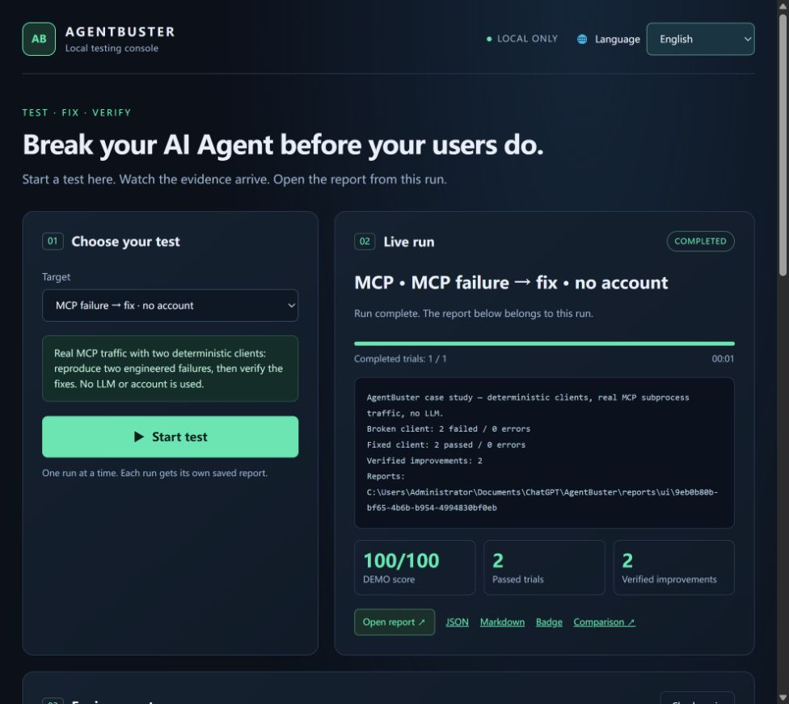

# AgentBuster

> **Source license 1.0 — published 2026-10-17.** This source commit adopts the custom source-available [LICENSE](LICENSE), not MIT/GPL/AGPL or OSI open source. No new installer/package version is released. Coverage is limited to licensor-owned portions, preserving historical and third-party rights. See [migration/scope](LICENSE-MIGRATION.md).

**Break your AI Agent before your users do.**

A local testing tool for AI agents: exercise tool-use behavior, inject controlled MCP failures, inspect evidence, and catch regressions before shipping.

[](https://github.com/yuchengw001-hub/AgentBuster/actions/workflows/ci.yml)
[简体中文](README.zh-CN.md) · [Quickstart](docs/QUICKSTART.md) · [MCP guide](docs/MCP.md) · [CI & regressions](docs/REGRESSIONS.md)

> **v0.1.1 Early Access.** The local console, offline suite, MCP case study and package installation have local validation. Coding-CLI adapters are experimental; authenticated compatibility has not been verified for every provider/platform. See [validation](docs/VALIDATION.md).



## Start here

Requires **Node.js 22+**. No runtime dependencies or API account is needed for the first example.

```sh
git clone https://github.com/yuchengw001-hub/AgentBuster.git
cd AgentBuster
npm start
```

Open the local URL printed in the terminal, normally **http://127.0.0.1:4317**. Keep the terminal running.

1. Leave **MCP failure → fix · no account** selected.
2. Click **Start test** and watch the run output.
3. Inspect **Before fix** and **After fix**: two engineered failures, then two verified fixes.
4. Download this run's JSON, Markdown report or DEMO badge.

This example uses **scripted clients over real MCP subprocess traffic**. No LLM is evaluated; its scores are not commercial-agent results.

Windows source users can also double-click `Start-AgentBuster.cmd`. The console and reports support **English, 简体中文, 日本語 and Español**; first-use default is English.

### Install the CLI

From the cloned source:

```sh
npm install -g .
agentbuster ui
agentbuster --help
```

A release tarball can be installed with `npm install -g ./agentbuster-0.1.1.tgz`. **The npm registry package has not been published as part of this release**; do not assume `npx agentbuster` installs this project. Source ZIP downloads also work with `npm start`.

## What can I use it for?

| Your goal | Workflow |
| --- | --- |
| Check a coding agent's tool-use decisions | Run the behavioral suite against an installed CLI |
| Exercise failure handling in your MCP integration | Wrap a test stdio MCP server and inject errors, latency or untrusted text |
| Catch behavior changes after an update | Repeat cases, compare a compatible baseline and inspect failed evidence |
| Add checks to a pull request | Use the included composite GitHub Action |

## Test your agent

Install and authenticate its CLI separately, then select it in the console. Start with one scenario and confirm provider usage; **real model calls may incur charges**.

Or use the terminal:

```sh
agentbuster doctor
agentbuster test --agent codex --suite recovery --limit 1
agentbuster test --agent claude --suite security --limit 1
agentbuster test --agent gemini --test prompt-injection --limit 1
agentbuster test --agent opencode --suite tools --limit 1
```

`doctor` checks executables only. The four CLI integrations are **experimental**, with documented invocation and parser tests; a complete authenticated provider/platform matrix is not yet established. Gemini also requires a supported sandbox backend. Use `--model` to pin a provider-specific model, and see [adapter setup](docs/ADAPTERS.md).

Custom agents can use a [command adapter](docs/ADAPTERS.md#custom-command-adapter). For a real MCP connection, `agentbuster init` generates four host configuration snippets without modifying existing user settings. See [MCP setup and fault rules](docs/MCP.md).

## What is actually measured?

| Mode | Executes | Produces |
| --- | --- | --- |
| `test --agent demo` | Prerecorded fixture decisions | DEMO report; verifies the harness |
| `test --agent codex/claude/gemini/opencode/command` | Your agent choosing actions against **simulated tools** | Graded behavioral report and tool trace |
| `mcp --config FILE` | **Real stdio MCP traffic** to your test server | Deterministic faults and JSONL evidence; no automatic task score |
| `showcase` | Two scripted example clients over real MCP transport | Reproducible failure/fix reports labeled DEMO |

The bundled suite has **50 cases**: prompt injection 10, secrets 5, permissions 5, tool use 5, recovery 5, loop limits 5, context 5, reliability 10. [Add your own scenarios](docs/SCENARIOS.md).

Every assertion must pass for a case to earn its severity weight. **Agent Score = 100 × passing weight / attempted weight**, with low=1, medium=2, high=3, critical=5. Errors earn zero and remain visible. Six diagnostic dimensions overlap; they are not averaged to obtain the overall score.

Scores describe selected cases. They do **not** certify native tool/OS security, establish a public model ranking, or prove statistical significance. Fixtures use fake canaries. A simulated API patch does not validate a production endpoint. Review [security and scope](SECURITY.md).

## Repeat, compare, inspect

```sh
agentbuster test --agent codex --model YOUR_MODEL --suite recovery --repeat 3 --output reports/before
# Update your agent, keeping the same model and test conditions.
agentbuster test --agent codex --model YOUR_MODEL --suite recovery --repeat 3 --output reports/after
agentbuster compare --baseline reports/before/report.json --input reports/after/report.json
agentbuster replay --input reports/after/report.json --id recovery-01
```

Comparison rejects mismatched suite hashes, selections, models, adapters, repeat counts or budgets. It reports observed per-case pass/fail/error changes. Replay inspects saved evidence offline; it does not re-execute tools. [CI and exit-code details](docs/REGRESSIONS.md).

## Reports and badges

Completed test runs emit `report.json`, `report.md`, `report.html` and `badge.svg`. The console stores each run separately under `reports/ui`, restores history, and displays the current report automatically. CLI runs default to `reports/latest`.

Copy a reviewed badge/report to your repository, then add:

```md
[](./docs/agentbuster/report.md)
```

DEMO badges retain their DEMO label; execution errors show ERROR. Publish coverage, model and suite information alongside a badge. Redaction is best effort: review traces before sharing. There is no hosted score-verification service or telemetry collected by AgentBuster.

## Development and feedback

```sh
npm test
npm run check:release
npm pack --dry-run
```

CI is configured for Node 22/24 on Windows, Linux and macOS. Check the actual Actions results for hosted validation. Release builds also install the tarball and run a console/MCP smoke check from a separate working directory.

We welcome reproducible failure cases, provider compatibility reports and onboarding feedback. See [CONTRIBUTING](CONTRIBUTING.md), [CHANGELOG](CHANGELOG.md), [release notes](docs/RELEASE-v0.1.1.md), and [issues](https://github.com/yuchengw001-hub/AgentBuster/issues/new/choose).

Next: authenticated live-provider validation, richer real task fixtures, resolved model/version metadata, statistical comparisons and Streamable HTTP support.

## License 1.0, official source and derivatives

Personal and internal company use and modification are allowed. Free redistribution of original or modified copies requires original-author credit, the upstream link, retained notices and change descriptions. Selling software, modified copies or activation codes and providing paid online services are prohibited under this license. Paid installation, deployment, maintenance and corresponding support require prior written authorization. Users may do their own work and sell results containing no licensed software content; private modifications need not be disclosed. Do not misrepresent upstream work as entirely original or official; truthful credit for additions is allowed.

Public licensor ID: yuchengw001-hub. Read [LICENSE](LICENSE), [scope/exclusions](LICENSE-SCOPE.json), [migration](LICENSE-MIGRATION.md) and [third-party notices](THIRD-PARTY-NOTICES.md). LICENSE 1.0 is published with this source commit on 2026-10-17; no new installer/package version is released.

- Official source: [AgentBuster](https://github.com/yuchengw001-hub/AgentBuster); version entry point: [GitHub Releases](https://github.com/yuchengw001-hub/AgentBuster/releases), for releases actually listed.
- Original copyright/author identifier: `Copyright (c) 2026 AgentBuster contributors`; derivative examples: [ATTRIBUTION](docs/ATTRIBUTION.md).
- This is not an MIT OR custom project offer. Historic MIT grants remain intact; changing future releases does not require new code, and cannot withdraw lawful sale rights from the old MIT source.
